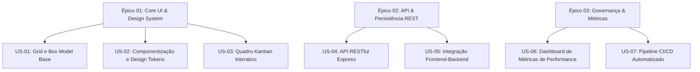
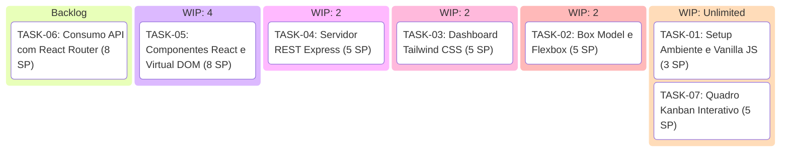

# PLANEJAMENTO E GESTÃO ÁGIL DE PROJETOS FRONT-END

**Instituição:** SENAI  
**Curso:** Especialização Técnica / Desenvolvimento Front-End  
**Disciplina:** Frameworks Front-End  
**Docente:** Prof. Me. Deivison S. Takatu  
**Atividade:** Atividade 03 - Gestão de Projetos Front-End (Scrum, Kanban, Requisitos e Git Flow)  
**Projeto Integrador Interdisciplinar:** *DevPulse Platform - Ecossistema Integrado de Gestão e Monitoramento Front-End*  

---

## 1. Contextualização e Justificativa

Conforme fundamentado nos conceitos da disciplina:
> *"Projetos Front-End modernos crescem rapidamente em escopo, dependências e complexidade. A ausência de um processo estruturado de gestão resulta em tarefas esquecidas, requisitos ambíguos, retrabalho, conflitos frequentes no repositório Git, atrasos no cronograma e gargalos de integração."*

A implementação de uma abordagem ágil híbrida (**Scrum** para cadência de entregas incrementais e **Kanban** para fluxo contínuo e visibilidade operacional) assegura:
1. **Responsabilidades Claras:** Cada membro da equipe conhece exatamente o que deve entregar.
2. **Priorização Orientada a Valor:** O esforço técnico concentra-se primeiro nas funcionalidades mais críticas.
3. **Entregas Frequentes e Incrementais:** Software funcionando ao final de cada iteração (Sprint).
4. **Visibilidade e Previsibilidade:** Métricas em tempo real sobre o ritmo da equipe (Velocity, Lead Time, Cycle Time).
5. **Mitigação de Riscos de Integração:** Políticas padronizadas de branches e testes contínuos.

---

## 2. Visão do Produto e Personas

### 2.1 Visão do Produto
> *"Para desenvolvedores e equipes de engenharia de software que necessitam gerenciar, monitorar e otimizar aplicações baseadas em frameworks front-end modernos, o **DevPulse** é uma plataforma integrada de gestão técnica e métricas em tempo real que centraliza catálogos de componentes, monitoramento de APIs REST e indicadores de compilação, diferentemente de ferramentas isoladas e dispersas."*

### 2.2 Personas Mapeadas
- **Persona 1: Dev Front-End Júnior (Lucas, 23 anos):** Precisa de documentação clara de componentes, guias visuais e branches organizadas para subir PRs sem conflito no Git.
- **Persona 2: Tech Lead / Arquiteto (Mariana, 32 anos):** Precisa acompanhar a velocidade do time, aprovar pull requests que cumpram a *Definition of Done* e monitorar a conformidade arquitetural da aplicação.
- **Persona 3: Product Owner (Carlos, 38 anos):** Precisa acompanhar o progresso das Sprints, priorizar o Backlog por valor de negócio e validar os critérios de aceite das User Stories.

---

## 3. Gestão de Requisitos do Sistema

### 3.1 Requisitos Funcionais (RF)
- **RF-01 (Módulo de Tarefas & Notas):** O sistema deve permitir criar, listar, editar e excluir notas e tarefas técnicas (CRUD completo integrado a endpoint REST).
- **RF-02 (Módulo de Métricas e KPIs):** O sistema deve exibir indicadores dinâmicos de desempenho (Lighthouse score, tamanho do bundle CSS/JS e status da API).
- **RF-03 (Catálogo de Componentes):** O sistema deve disponibilizar um design system pesquisável com visualização de componentes atômicos (Atoms, Molecules, Organisms).
- **RF-04 (Autenticação e Sessão):** O sistema deve gerenciar sessão do desenvolvedor com persistência local e tokens de acesso.
- **RF-05 (Board Kanban Interativo):** O sistema deve fornecer um quadro Kanban com arrastar e soltar (drag and drop) de cards entre estados do fluxo.

### 3.2 Requisitos Não-Funcionais (RNF)
- **RNF-01 (Performance):** A renderização de listas com até 500 itens deve ocorrer em menos de 100ms via reconciliação com Virtual DOM ou manipulação otimizada do DOM.
- **RNF-02 (Responsividade):** A interface deve ser 100% responsiva, adaptando-se a resoluções de smartphones (320px), tablets (768px) e monitores ultrawide (1920px+).
- **RNF-03 (Acessibilidade):** Elementos interativos devem seguir as diretrizes WCAG 2.1 nível AA, incluindo navegação por teclado (`Tab`, `Enter`), contraste de cor adequado e atributos ARIA.
- **RNF-04 (Compatibilidade de Browsers):** Suporte garantido às duas versões mais recentes do Google Chrome, Mozilla Firefox, Microsoft Edge e Safari.
- **RNF-05 (Versionamento e CI/CD):** Deploy automatizado a cada merge na branch principal (`main`) nas plataformas Vercel (Front-end) e Render (Back-end).

---

## 4. Product Backlog e User Stories

Cada história de usuário segue o padrão internacional:  
`Como [persona], quero [ação no sistema], para que [valor ou benefício gerado].`  
Todos os itens possuem critérios de aceite em formato **Gherkin (Dado / Quando / Então)**.



### Detalhamento das Histórias de Usuário:

#### US-01: Visualização do Quadro Kanban de Atividades
- **User Story:** *Como Desenvolvedor Front-End, quero visualizar minhas tarefas dispostas em colunas de status (Backlog, A Fazer, Em Andamento, Code Review, Concluído), para que eu possa acompanhar o fluxo de trabalho de forma clara.*
- **Critérios de Aceite:**
  - **Dado** que acesso a rota `/kanban`;
  - **Quando** o quadro carregar;
  - **Então** devo ver as colunas estruturadas, os cards contendo título, pontuação em Story Points, prioridade e tag do módulo;
  - **E** a contagem de tarefas por coluna deve respeitar os limites de WIP (*Work in Progress*).

#### US-02: Transição de Tarefas via Drag-and-Drop
- **User Story:** *Como Desenvolvedor da equipe, quero arrastar um card de uma coluna para outra, para que o status da tarefa seja atualizado instantaneamente sem recarregar a página.*
- **Critérios de Aceite:**
  - **Dado** que clico e seguro um card na coluna "Em Andamento";
  - **Quando** solto o card sobre a coluna "Code Review";
  - **Então** o estado visual é alterado imediatamente com animação fluida;
  - **E** a alteração é persistida no LocalStorage do navegador.

#### US-03: Cadastro e Edição de Tarefas Técnicas
- **User Story:** *Como Tech Lead, quero cadastrar novas tarefas técnicas informando título, estimativa em Fibonacci, prioridade MoSCoW e responsável, para que a equipe execute as demandas planejadas na Sprint.*
- **Critérios de Aceite:**
  - **Dado** que clico no botão "+ Nova Tarefa";
  - **Quando** preencho os campos obrigatórios e submeto o formulário;
  - **Então** um novo card é inserido na coluna "Sprint Backlog" com identificador único (`TASK-XXX`);
  - **E** campos vazios disparam validação nativa com feedback visual.

#### US-04: Consumo e Manipulação de Dados via API REST
- **User Story:** *Como Usuário, quero que o aplicativo consuma notas e tarefas da API Node/Express, para que meus dados estejam centralizados e sincronizados entre sessões.*
- **Critérios de Aceite:**
  - **Dado** que a aplicação inicia;
  - **Quando** o Hook `useEffect` dispara a chamada `GET /api/notes`;
  - **Então** um indicador de carregamento ("Skeleton Loader") é exibido até o recebimento do JSON;
  - **E** em caso de falha de conexão com a API, uma mensagem de erro amigável com botão de "Tentar Novamente" deve aparecer.

---

## 5. Priorização (Técnica MoSCoW) e Estimativas (Story Points)

### 5.1 Matriz MoSCoW de Priorização
- **Must Have (Obrigatório para o MVP):**
  - Criação da estrutura semântica HTML5 e Box Model externo (US-01);
  - Estilização utilitária com Tailwind CSS (US-02);
  - Servidor Express.js com rotas CRUD e CORS configurado (US-04);
  - Quadro Kanban funcional com persistência (US-03).
- **Should Have (Importante, mas postergável):**
  - Filtros dinâmicos de tarefas por prioridade e responsável;
  - Coleção completa no Postman para homologação de endpoints;
  - Suporte a Dark Mode com alternador persistente.
- **Could Have (Desejável caso haja tempo hábil):**
  - Gráfico de Burndown Chart dinâmico em KaTeX / SVG;
  - Exportação de dados do Kanban em formato JSON/CSV.
- **Won't Have (Fora do escopo da iteração atual):**
  - Autenticação corporativa com SSO/OAuth2 complexo;
  - Suporte a WebSockets em tempo real com Redis cluster.

### 5.2 Tabela de Estimativas em Story Points (Sequência de Fibonacci)

| ID | Descrição da Tarefa Técnica | Prioridade | Complexidade Técnica | Story Points |
|---|---|---|---|:---:|
| **TASK-01** | Desenvolver esqueleto semântico HTML5 e folha externa de Box Model | Must Have | Baixa (Estrutura e CSS3) | **3 SP** |
| **TASK-02** | Implementar 20 regras Flexbox responsivas com alinhamentos avançados | Must Have | Média (Refinamento responsivo) | **5 SP** |
| **TASK-03** | Configurar Tailwind CSS via CDN e construir dashboard analítico | Must Have | Média (30+ classes utilitárias) | **5 SP** |
| **TASK-04** | Criar API RESTful em Express.js com persistência em `data.json` | Must Have | Média (CRUD, Middlewares, CORS) | **5 SP** |
| **TASK-05** | Desenvolver aplicação React com componentes, props e Virtual DOM | Must Have | Alta (Ciclo de vida e estado) | **8 SP** |
| **TASK-06** | Integrar consumo da API REST via Fetch e gerenciar rotas com React Router | Must Have | Alta (Assincronismo e SPA) | **8 SP** |
| **TASK-07** | Construir Quadro Kanban interativo com Drag-and-Drop nativo | Should Have | Média (Manipulação de eventos DOM) | **5 SP** |
| **TASK-08** | Documentar coleção Postman com variáveis de ambiente e testes HTTP | Should Have | Baixa (Documentação e testes) | **3 SP** |
| **TASK-09** | Configurar pipelines de deploy no Render (backend) e Vercel (frontend) | Must Have | Baixa (DevOps e CI/CD) | **2 SP** |
| **Total** | **Capacidade total planejada para 3 Sprints** | — | — | **44 SP** |

---

## 6. Planejamento das Sprints (Ciclos Scrum de 2 Semanas)

### Sprint 1: Fundação de UI, Box Model e Estilização Utilitária
- **Meta da Sprint (Sprint Goal):** Estabelecer a arquitetura de apresentação com domínio pleno do Box Model, Flexbox e Tailwind CSS, entregando a interface base do projeto.
- **Backlog da Sprint:** TASK-01, TASK-02, TASK-03, TASK-07.
- **Capacidade Planejada:** 18 Story Points.
- **Entregável:** Páginas de visualização de Box Model/Flexbox e Dashboard Tailwind rodando localmente e via Vercel.

### Sprint 2: Backend em Node/Express e Integração de APIs
- **Meta da Sprint (Sprint Goal):** Desenvolver o servidor RESTful com persistência em JSON, homologar endpoints via Postman e realizar deploy contínuo no Render.
- **Backlog da Sprint:** TASK-04, TASK-08, TASK-09.
- **Capacidade Planejada:** 10 Story Points.
- **Entregável:** API online no Render (`https://devpulse-api.onrender.com/api/notes`) com coleção Postman testada e aprovada.

### Sprint 3: Componentização React, Hooks e SPA Completa
- **Meta da Sprint (Sprint Goal):** Construir a Single Page Application em React integrando formulários controlados, roteamento dinâmico e sincronização bidirecional com a API.
- **Backlog da Sprint:** TASK-05, TASK-06.
- **Capacidade Planejada:** 16 Story Points.
- **Entregável:** Aplicação full-stack completa integrada e documentada com relatórios técnicos ABNT.

---

## 7. Quadro Kanban de Gestão Operacional

Para evitar sobrecarga de trabalho e gargalos técnicos, foram estipulados limites estritos de **Trabalho em Progresso (WIP Limits)** em cada estágio do fluxo:



### Regras de Operação do Kanban:
1. **Puxar Tarefas (Pull System):** Um desenvolvedor só puxa uma nova tarefa de "Sprint Backlog" para "In Progress" quando o limite WIP da coluna permitir.
2. **Bloqueios (Impedimentos):** Tarefas com impedimentos recebem a flag visual vermelha e devem ser abordadas na reunião diária (Daily Scrum).
3. **Métrica de Fluxo:** Acompanhamento diário do *Cycle Time* (tempo decorrido desde o início em "In Progress" até "Done").

---

## 8. Critérios de Qualidade: Definition of Ready (DoR) e Definition of Done (DoD)

Conforme enfatizado na Aula 06 do curso:
> *"Definition of Done estabelece critérios objetivos para considerar uma tarefa realmente concluída dentro do projeto, evitando entregas incompletas ou com débitos técnicos."*

### 8.1 Definition of Ready (DoR - Critérios para Iniciar uma Tarefa)
Uma tarefa só pode sair do Backlog e entrar em Sprint quando:
- [x] História de usuário formulada com clareza (Persona + Desejo + Benefício);
- [x] Critérios de aceite explícitos definidos (formato Gherkin);
- [x] Estimativa em Story Points atribuída por consenso do time;
- [x] Dependências externas (APIs, bibliotecas, assets) identificadas e acessíveis;
- [x] Protótipo de interface (wireframe ou mockup) aprovado.

### 8.2 Definition of Done (DoD - Critérios para Considerar Concluída)
Uma tarefa só transiciona para a coluna "Done" quando:
- [x] Código-fonte implementado seguindo padrões de Clean Code e convenções do framework;
- [x] Testes manuais ou unitários executados com 100% de aprovação nos cenários de teste;
- [x] Responsividade verificada em múltiplos tamanhos de tela (Mobile, Tablet, Desktop);
- [x] Acessibilidade básica validada (elementos semânticos, contraste, foco visual);
- [x] Pull Request revisado e aprovado por pelo menos um colega (*Peer Review*);
- [x] Branch integrada à branch `develop`/`main` sem conflitos de merge;
- [x] Deploy efetuado no ambiente de homologação/produção e validado ao vivo;
- [x] Documentação técnica atualizada no `README.md` do repositório.

---

## 9. Estratégia de Versionamento Git e Fluxo de Branches

A equipe adota o modelo **Git Flow adaptado para Trunk-Based Development**, garantindo estabilidade no branch de produção e facilidade de integração contínua.

### 9.1 Hierarquia de Branches
- `main`: Branch de código em produção, estável, protegido contra push direto. Cada merge gera deploy automático no Vercel/Render.
- `develop`: Branch de integração contínua onde as features finalizadas são reunidas e testadas conjuntamente.
- `feature/<nome-da-funcionalidade>`: Branches efêmeras criadas a partir de `develop` para desenvolvimento isolado (ex.: `feature/kanban-drag-drop`, `feature/express-notes-api`).
- `hotfix/<correcao-critica>`: Branches emergenciais criadas a partir de `main` para correção rápida de bugs em produção.

### 9.2 Convenção de Commits Semânticos (Conventional Commits)
Todos os commits seguem a convenção semântica padronizada:
- `feat: <descricao>` &rarr; Nova funcionalidade adicionada ao sistema.
- `fix: <descricao>` &rarr; Correção de bug no código.
- `docs: <descricao>` &rarr; Alterações exclusivamente na documentação (`README.md`, etc.).
- `style: <descricao>` &rarr; Ajustes visuais, CSS, formatação sem impacto na lógica.
- `refactor: <descricao>` &rarr; Refatoração de código sem alteração de comportamento.
- `chore: <descricao>` &rarr; Atualização de dependências ou configurações de build.

### 9.3 Roteiro de Comandos Git Padronizados

```bash
# 1. Iniciar uma nova funcionalidade a partir da develop
git checkout develop
git pull origin develop
git checkout -b feature/kanban-drag-drop

# 2. Realizar alterações e commitar com semântica
git add .
git commit -m "feat(kanban): implementa funcionalidade de drag and drop nas colunas"

# 3. Manter a branch atualizada com a base
git fetch origin
git rebase origin/develop

# 4. Enviar a branch para o repositório remoto
git push -u origin feature/kanban-drag-drop

# 5. Criar Pull Request no GitHub com checklist de DoD
# Após aprovação e merge do PR:
git checkout develop
git pull origin develop
git branch -d feature/kanban-drag-drop
```

---

## 10. Cerimônias e Ritos da Metodologia Ágil

| Cerimônia | Frequência / Duração | Participantes | Objetivo Principal |
|---|---|---|---|
| **Sprint Planning** | Início da Sprint (2h) | Todo o time | Definir a Sprint Goal e selecionar os itens do Backlog a serem executados. |
| **Daily Scrum** | Diária (15 min) | Time de Devs + PO | Alinhar o andamento: *O que fiz ontem? O que farei hoje? Há algum impedimento?* |
| **Sprint Review** | Fim da Sprint (1h) | Time + Docente/Stakeholders | Demonstrar os incrementos de software funcionando na prática. |
| **Sprint Retrospective** | Fim da Sprint (45 min) | Time de Desenvolvimento | Identificar pontos positivos, oportunidades de melhoria e plano de ação contínuo. |

---

## 11. Conclusão da Documentação

A estrutura de gestão ágil documentada acima consolida todos os tópicos ministrados na **Aula 06 (Projetos Front-End)** e atende integralmente à proposta pedagógica do SENAI, fornecendo a base metodológica para as entregas de código em React, Tailwind CSS e APIs que compõem o ecossistema interdisciplinar.
